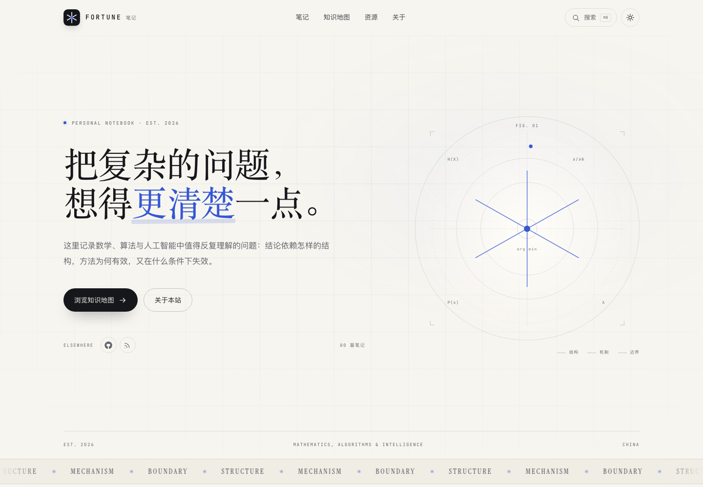

# Fortune Arterial

个人博客，线上地址：**<https://fortune-arterial.github.io>**

目前**还没有发布任何文章**：骨架、页面、搜索、知识地图与部署流程已经就位，内容留待之后填写。

推送 `main` 即自动构建并发布到 GitHub Pages。



## 现在的状态

| 部分 | 状态 |
| --- | --- |
| 首页 / 笔记 / 知识地图 / 关于 / 资源 / 404 | 已完成 |
| Markdown 文章系统、公式、代码高亮、提示框 | 已完成 |
| 全文搜索、明暗主题、RSS、sitemap、SEO | 已完成 |
| 知识地图（15 个概念、7 个学科） | 数据与交互已完成，节点等待笔记点亮 |
| 文章 | **0 篇**（示例文章在 `examples/posts/`，不会被构建） |
| GitHub Actions 部署 | 已完成，线上运行中 |
| 线上地址 | <https://fortune-arterial.github.io> |

## 技术栈

纯静态站点，没有前端框架，没有数据库，没有运行时服务。

- **构建**：一段约 800 行的 Node 脚本（`src/build.mjs` + `src/lib/`）
- **写作**：Markdown + YAML front matter
- **公式**：KaTeX 在构建时渲染为静态 HTML
- **样式**：手写 CSS，自托管 Inter / Instrument Serif / JetBrains Mono
- **交互**：原生 JavaScript，负责搜索、主题、目录、筛选与知识地图
- **部署**：GitHub Actions → GitHub Pages

## 快速开始

需要 Node.js 20 或更高版本。

```bash
npm install
npm run dev
```

打开 <http://127.0.0.1:4321>。修改 `content/`、`src/` 或 `site.config.mjs` 后会自动重建。

其他命令：

```bash
npm run build     # 生成 dist/
npm run preview   # 预览已构建的 dist/
npm run new -- my-note "一篇新笔记"   # 创建草稿
```

## 把它变成你的

站点身份已经指向你：

```js
siteUrl: "https://fortune-arterial.github.io",
basePath: "/",
name: "Fortune Arterial",
wordmark: "FORTUNE",
socials: [
  { label: "GitHub", href: "https://github.com/fortune-arterial", icon: "github" },
  { label: "RSS", href: "/rss.xml", icon: "rss" },
],
```

需要你补充的：

- [ ] `site.config.mjs` 中的 `author.email`（留空时页脚显示 GitHub；填上后显示邮箱）与 `author.location`（关于页的时区/坐标可一并调整）
- [ ] `content/pages/about.md` 里的自我介绍（现在是通用文案）
- [ ] `src/data/resources.mjs` 里的资源清单（现在是起始版本）
- [ ] `public/og.png` 社交分享卡片（可换成自己的设计，1200×630）
- [ ] `public/apple-touch-icon.png` 与 `public/favicon.svg`（可选）
- [ ] `LICENSE` 中的版权人
- [ ] 知识地图 `src/data/map.mjs` 中的概念与坐标（可选）

### 部署到 GitHub Pages

目标仓库必须叫 **`fortune-arterial.github.io`**：

1. 在 GitHub 新建公开仓库 `fortune-arterial/fortune-arterial.github.io`。
2. 推送本地代码：

   ```bash
   git remote add origin https://github.com/fortune-arterial/fortune-arterial.github.io.git
   git push -u origin main
   ```

3. 打开仓库 **Settings → Pages → Build and deployment**，把 Source 设为 **GitHub Actions**。
4. 等待 `Deploy to GitHub Pages` workflow 完成，访问 <https://fortune-arterial.github.io>。

之后每次推送到 `main` 都会自动构建并发布。构建产物 `dist/` 不进入版本库。

**自定义域名**：在 Pages 设置中绑定域名，把 `siteUrl` 改为 `https://your-domain.com`、`basePath` 保持 `/`，并在 `public/` 下添加内容为域名的 `CNAME` 文件。

**项目站点**（`https://<username>.github.io/<repo>`）：把 `basePath` 改为 `/<repo>/`，`siteUrl` 写 `https://<username>.github.io/<repo>` 或只写域名均可（`abs()` 会避免重复拼接），重新构建即可。

> `basePath` 必须以 `/` 开头和结尾。导航、字体、图片、RSS 与搜索索引都会自动加上这个前缀；Markdown 正文里的绝对图片路径需要自行处理。

## 写作

文章放在 `content/posts/*.md`，文件名就是 URL：

```
content/posts/typical-set.md  →  /notes/typical-set/
```

完整示例见 `examples/posts/`（7 篇，涵盖公式、表格、代码、提示框与知识地图关联）。启用方式：

```bash
cp examples/posts/typical-set.md content/posts/
# 修改 front matter 后
npm run build
```

Front matter 示例：

```yaml
---
title: "典型集与 AEP：概率质量为何集中在薄壳上"
subtitle: "从渐近均分性理解高维概率的几何直觉"
date: "2026-01-21"
category: "信息论"
tags: ["典型集", "AEP", "信息论"]
concepts: ["typical-set", "entropy"]
excerpt: "一两句话摘要，会出现在列表、搜索与社交卡片中。"
draft: false
---
```

- `category` 必须是 `src/data/map.mjs` 中 `categories` 的键。
- `concepts` 是知识地图里的概念 ID。**第一个概念是文章的主节点**，会点亮地图；其余概念用于关联与相关阅读。
- `draft: true` 的文章不会进入构建。
- 公式：行内 `$x_t$`，独立成行 `$$ ... $$`。
- 提示框：

  ```md
  ::: note 直觉
  这里是一段补充说明。
  :::
  ```

  支持 `note`、`tip`、`warn`。
- 图片放在 `public/images/`。用户站点可以用 `/images/xxx.png`；如果部署在子路径，请写完整的 `basePath` 路径（`/notes/images/xxx.png`），或使用相对路径。Markdown 中的图片地址不会被自动加上 `basePath`。

详细规范见 [`CONTENT_GUIDE.md`](CONTENT_GUIDE.md)。

新增概念：编辑 `src/data/map.mjs`，添加节点（含 `x` / `y` 坐标）与连线，然后把概念 ID 写进文章 front matter。

## 项目结构

```
.
├── content/
│   ├── pages/about.md          # 关于页正文
│   └── posts/                  # 文章（目前为空）
├── examples/posts/             # 不参与构建的示例文章
├── public/                     # favicon、OG 图、字体、图片
├── scripts/                    # dev / preview / new-post
├── src/
│   ├── build.mjs               # 构建入口与页面模板
│   ├── data/map.mjs            # 知识地图数据
│   ├── data/resources.mjs      # 资源页数据
│   ├── lib/
│   │   ├── content.mjs         # 读取、校验、排序文章
│   │   ├── markdown.mjs        # Markdown + KaTeX + 代码高亮
│   │   ├── layout.mjs          # 页头、页脚、地图、搜索弹窗
│   │   └── site.mjs            # URL、日期、阅读时间等工具
│   ├── scripts/site.js         # 客户端交互
│   └── styles/site.css         # 全部样式
├── site.config.mjs             # 站点配置
└── .github/workflows/deploy.yml
```

构建时会复制 `public/`、CSS、JS、字体与 KaTeX 资源，并生成：

```
dist/
├── index.html
├── notes/index.html
├── map/index.html
├── about/index.html
├── resources/index.html
├── 404.html
├── search.json
├── rss.xml
├── sitemap.xml
├── robots.txt
└── assets/…
```

有文章后还会生成 `notes/<slug>/index.html`，并自动更新首页、笔记列表、搜索索引、RSS 与 sitemap。

## 设计说明

- **排版**：Instrument Serif（标题）+ Inter（正文/界面）+ JetBrains Mono（标签与数字），中文回退到宋体/苹方。字体自托管在 `public/fonts/`。
- **颜色**：暖纸色背景、钴蓝强调色、深色页脚。token 在 `src/styles/site.css` 顶部的 `:root` 与 `[data-theme="dark"]`。
- **知识地图**：坐标基于 1000×600 画布，构建时生成 SVG，交互由 `site.js` 完成。没有笔记时所有节点为空心。
- **无跟踪**：默认不加载任何统计或分析脚本。

## 常见问题

**首页 / 笔记页是空的？** 这是预期状态：目前没有发布文章。把 `examples/posts/` 中的示例复制到 `content/posts/`，或运行 `npm run new` 创建第一篇。

**页面样式或链接 404？** 检查 `basePath` 是否与部署路径一致，然后重新构建。

**Actions 部署失败？** 确认 Settings → Pages 的 Source 是 GitHub Actions，并允许 workflow 的 `pages: write` 权限（已写在 workflow 中）。

**公式显示为源码？** 确认安装了 `katex` 依赖，并检查构建日志；公式只在构建时渲染。

**想换主题色？** 修改 `site.css` 中的 `--accent`（亮色）与 `[data-theme="dark"]` 下的 `--accent`。分类颜色在 `.cat-*` 规则中。

## 许可

- 代码：[MIT](LICENSE)
- 文字内容：CC BY-NC-SA 4.0

“Fortune Arterial”是站点当前的品牌占位，可随时在 `site.config.mjs` 中修改。
